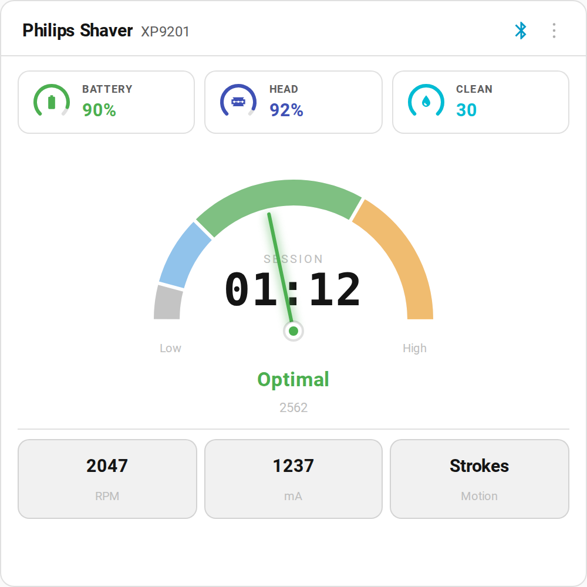
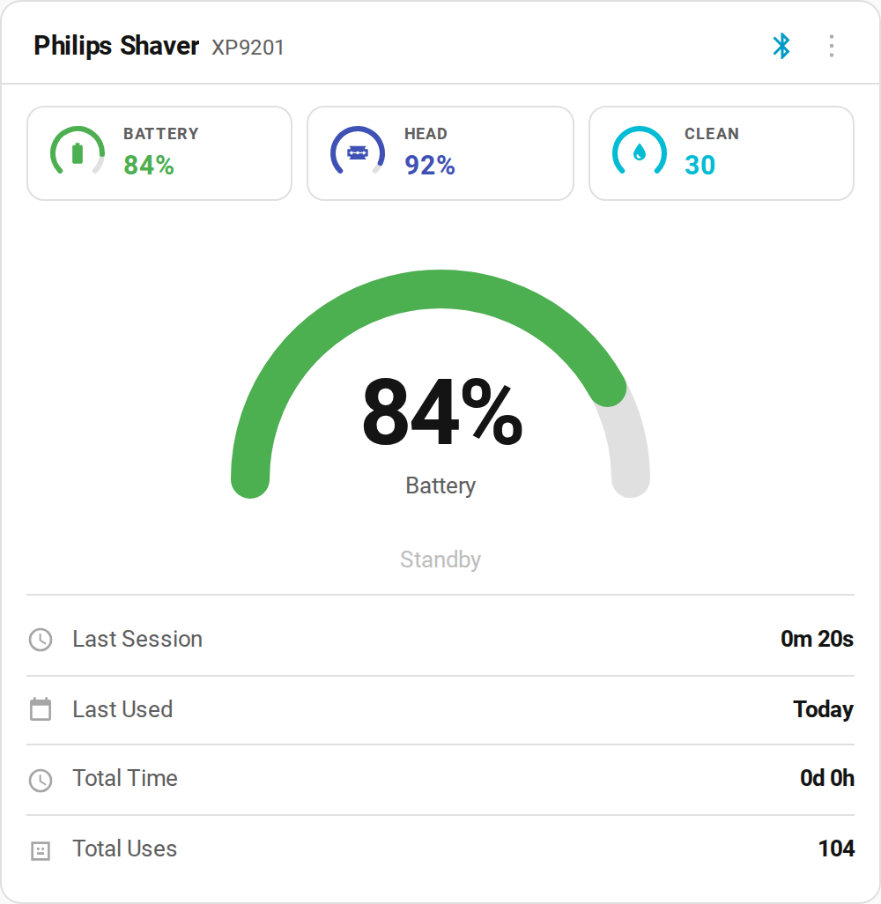
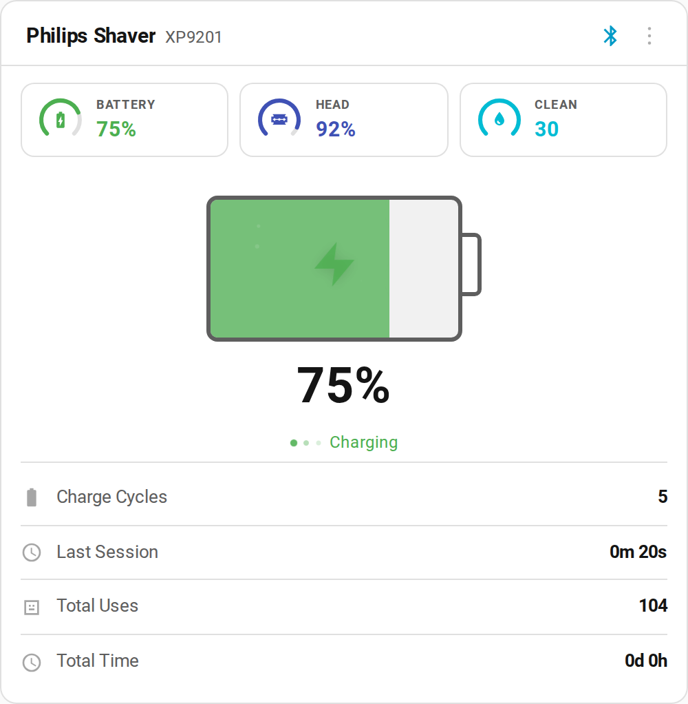
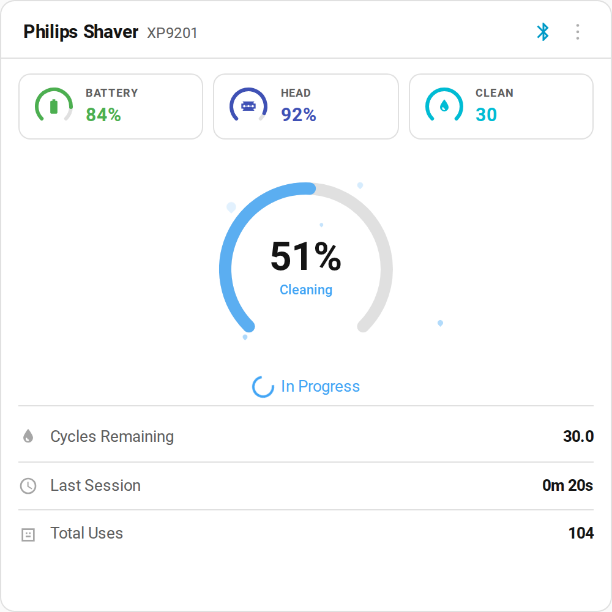
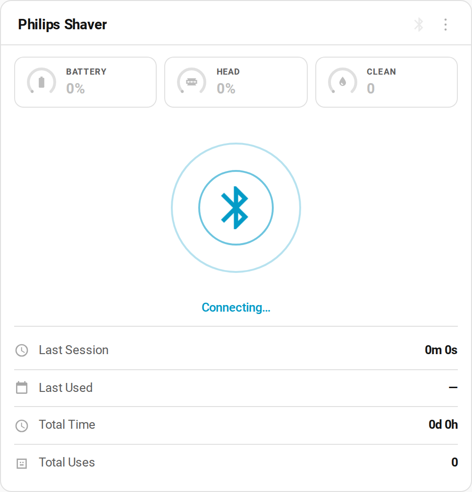
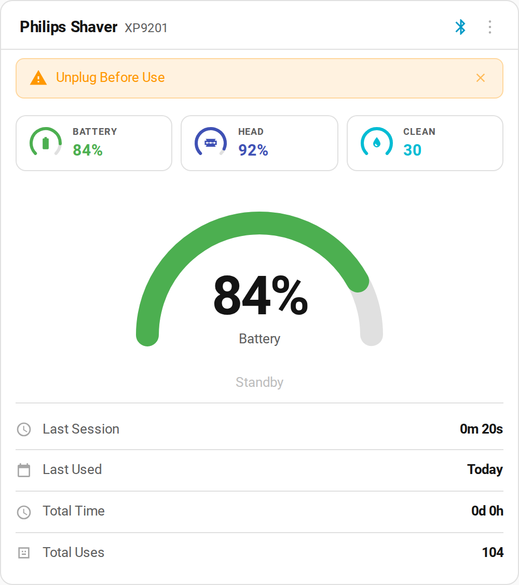
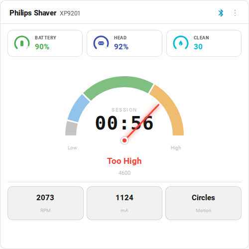
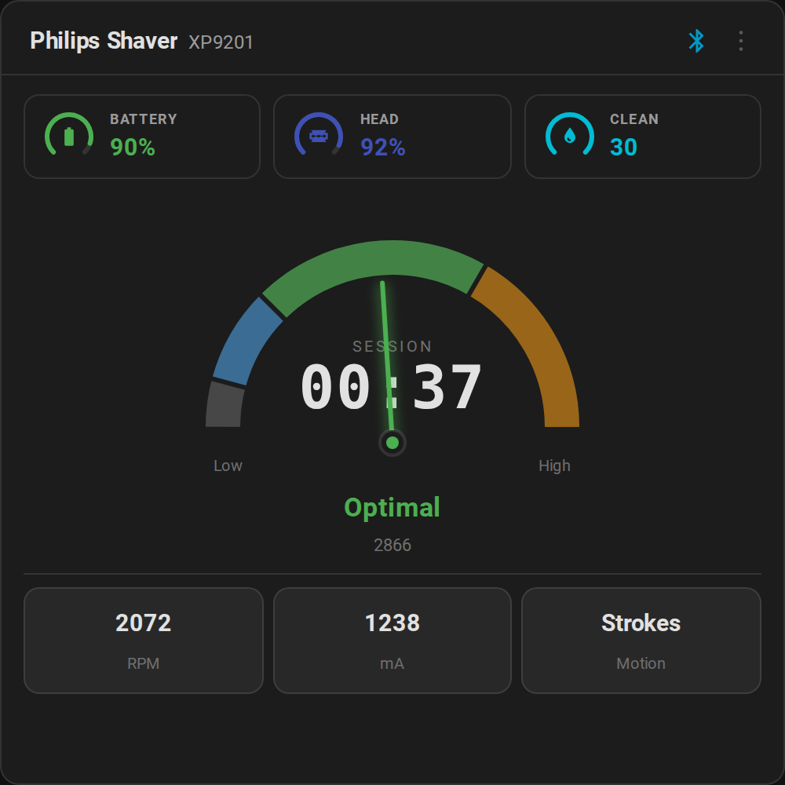

# Philips Shaver Card

[](https://github.com/mtheli/philips_shaver_card/releases)
[](LICENSE)

Custom Lovelace card for the [Philips Shaver](https://github.com/mtheli/philips_shaver) Home Assistant integration.

> [!IMPORTANT]
> **The card now ships with the [Philips Shaver integration](https://github.com/mtheli/philips_shaver)** (v0.18.0 and newer) — no separate installation needed anymore. If you installed the card from this repository, please remove it: uninstall *Philips Shaver Card* in the Marketplace (in HACS before Home Assistant 2026.11; this also removes the dashboard resource), or delete the manually added resource. Your dashboards keep working unchanged — the card type stays `custom:philips-shaver-card`.
>
> This repository remains the home of the card's source code and issue tracker, but there will be no further standalone releases. Card updates ship with integration releases.

<a href="./screenshots/shaving.png"></a>

## Features

- **Pressure gauge** with animated needle during shaving (blue/green/orange zones)
- **Battery gauge** with animated charging visualization
- **Cleaning ring gauge** with droplet animation during cleaning cycles
- **Shaver head** remaining bar
- **OneBlade support** with speed gauge and adapted stats
- **Notification banner** — active warnings (motor blocked, head replacement, etc.) shown as dismissible alerts with per-notification clearing
- **Connecting animation** — animated Bluetooth icon while the integration is initializing
- **Context-dependent stats**: motor RPM & current during shaving, session history in standby, charge info while charging
- **Clickable elements** — tap header, battery, or head bar to open the entity's more-info dialog
- **Multi-language support** — English and German, auto-detected from your Home Assistant language setting

The card automatically switches between modes based on the shaver's activity state:

| Standby | Shaving | Charging | Cleaning |
| :---: | :---: | :---: | :---: |
| <a href="./screenshots/standby.png"></a> | <a href="./screenshots/shaving.png"></a> | <a href="./screenshots/charging.png"></a> | <a href="./screenshots/cleaning.png"></a> |

| Connecting | Warning | Too Much Pressure | Dark Theme |
| :---: | :---: | :---: | :---: |
| <a href="./screenshots/connecting.png"></a> | <a href="./screenshots/warning.png"></a> | <a href="./screenshots/pressure_high.png"></a> | <a href="./screenshots/dark.png"></a> |

## Community

- [Smartes Badezimmer? So hilft dir ein Shelly Wall Display beim Zähneputzen & Rasieren!](https://www.youtube.com/watch?v=ROI91x2Swv8) — Video by [@smartmatic](https://github.com/smartmatic) showing the card on a Shelly Wall Display with XP9405 and ESP32 Bridge (German)
- [Philips Rasierer in Home Assistant integrieren und per Philips Shaver Karte ins Dashboard](https://www.youtube.com/shorts/ILX4mZ7Vg58) — YouTube Short by [@smartmatic](https://github.com/smartmatic) showing the setup and the card (German)

## Installation

The card is bundled with the [Philips Shaver integration](https://github.com/mtheli/philips_shaver) (v0.18.0+). Installing the integration — via the Marketplace or manually — is all you need; the card registers itself automatically, no dashboard resource setup required.

## Configuration

The card uses a visual editor — just add a card and select **Philips Shaver Card** from the list. Pick your shaver device and you're done.

### YAML

```yaml
type: custom:philips-shaver-card
device_id: <your-device-id>
title: My Shaver   # optional, defaults to the device's name
show_model: true   # optional, show model number as subtitle (default: true)
```

## Supported Languages

| Language | Code |
| --- | --- |
| English | `en` |
| German / Deutsch | `de` |

The card automatically uses your Home Assistant language setting. Unsupported languages fall back to English. Contributions for additional languages are welcome: copy `src/locales/en.json` to `src/locales/<code>.json`, translate the values, and register the new file in `src/translations.js` (add an `import` and an entry in `LOCALES`).

## Requirements

- [Philips Shaver](https://github.com/mtheli/philips_shaver) integration (v0.18.0+, which ships this card)
- Home Assistant 2024.11.0+

## Disclaimer

This is an independent community project and is not affiliated with, endorsed by, or sponsored by Philips. All product names, trademarks, and registered trademarks are property of their respective owners.

## License

[MIT](LICENSE)
